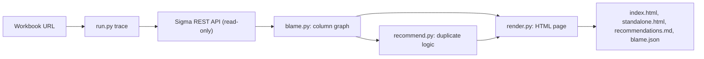

# Navigable Entity Relationship Diagram for Sigma

Column-level lineage and ownership for any [Sigma](https://www.sigmacomputing.com) workbook, with recommendations for logic that is written more than once.

Point it at a workbook and it traces every column back through the workbook's elements and data models to the warehouse table. You get one searchable HTML page where you can click a column and see every column that feeds it, where each one lives, whether it is a plain pass-through or a calculation, and **who owns that layer**. It answers two questions that come up constantly:

- **Who do I need to bring in?** When a number is wrong or a dashboard needs extending, the logic is often spread across a workbook and several data models owned by different people.
- **What can I delete?** Duplicated lookups, the same formula pasted into five elements, and hidden columns nobody uses all add up.

It runs as a skill inside [Claude](#use-it-with-claude), as a plain command-line tool you can use [without any AI at all](#use-it-from-the-command-line), or with [other LLMs and agents](#use-it-with-other-llms-and-agents).

> **Unofficial project.** This is a personal, open-source tool. It is not made, endorsed, or supported by Sigma Computing. "Sigma" is a trademark of its owner. It only reads from the public Sigma REST API.

> **Try it first, with no Sigma account.** `python3 examples/offline_demo.py` runs the whole tool against a fictional workbook and writes the result to `examples/sample-output/`. A ready-made copy is already there: open [`examples/sample-output/standalone.html`](examples/sample-output/standalone.html) in a browser.

---

## Contents

- [What you get](#what-you-get)
- [Quick start](#quick-start)
- [Requirements](#requirements)
- [Sign in](#sign-in)
- [Use it from the command line](#use-it-from-the-command-line)
- [Use it with Claude](#use-it-with-claude)
- [Use it with other LLMs and agents](#use-it-with-other-llms-and-agents)
- [Where results are saved](#where-results-are-saved)
- [Share the results](#share-the-results)
- [Reading the page](#reading-the-page)
- [The recommendations](#the-recommendations)
- [Ownership](#ownership)
- [How it works](#how-it-works)
- [Privacy and security](#privacy-and-security)
- [Limitations](#limitations)
- [Troubleshooting](#troubleshooting)
- [Development](#development)
- [License](#license)

---

## What you get

Every run produces a self-contained page with these parts:

| Part | What it does |
|---|---|
| **Trace a column** | Search any column by name. Click a result and an ERD of just that column appears: every column that feeds it, drawn left to right, each card showing the column's full name, where it lives (element and object), who owns that layer, and whether it is pass-through or calculated. |
| **Focus** and **Open** | Every card has **Focus** (make that column the new center of the diagram) and **Open ↗** (jump to that element in Sigma, in edit mode). |
| **Recommendations** | A collapsible section (collapsed by default, with live statistics) listing duplicated logic that could be removed. Filter by type, impact or owner. |
| **Isolate** | On any card named in a recommendation, one click reduces the diagram to just the cards that must change, each labelled with its role ("Remove this lookup", "Use this column instead", "Uses the lookup: re-point it"). The recommendation is pinned in a header above the diagram. |
| **Object lineage** | A diagram of the workbook, the data models behind it, and the warehouse sources, with owners. |
| **Who owns each object** | A roster of every workbook and data model in the chain, its owner, last editor, and how many columns have logic applied there. |
| **Column blame table** | Every element's columns with a Pass-through or Calculated badge, the layers that apply logic (with formulas), and the origin. Filter by element, person, or text. Shows calculated columns only by default. |

It also writes the recommendations as a Markdown file you can paste into a ticket.



---

## Quick start

```bash
git clone https://github.com/mattmorgenroth/sigma-navigable-erd.git
cd sigma-navigable-erd
pip install -r skills/sigma-navigable-erd/requirements.txt

# 1. See it work with no credentials (fictional data)
python3 examples/offline_demo.py

# 2. Tell it your Sigma API host (not a secret; yours depends on your Sigma cloud and region)
mkdir -p ~/.sigma-lineage && chmod 700 ~/.sigma-lineage
echo 'SIGMA_BASE_URL="https://api.sigmacomputing.com"' > ~/.sigma-lineage/credentials.env

# 3. Sign in once with your browser (no API client or secret needed)
python3 skills/sigma-navigable-erd/scripts/run.py login

# 4. Check it works
python3 skills/sigma-navigable-erd/scripts/run.py check

# 5. Trace a workbook: paste its URL, its url-id, or its UUID
python3 skills/sigma-navigable-erd/scripts/run.py trace "https://app.sigmacomputing.com/<org>/workbook/<name>-<urlId>"
```

The script prints where it saved the page. Open `standalone.html` from that folder in any browser.

---

## Requirements

- **Python 3.9 or newer** and **PyYAML** (`pip install -r skills/sigma-navigable-erd/requirements.txt`). Nothing else: the tool uses only the standard library otherwise.
- **A Sigma sign-in** for the organization that holds the workbook. By default you **sign in once with your browser** and the tool acts as you: there is no secret to create or store. Your account type may need the **Use Sigma API with OAuth** permission (Sigma documents this for its CLI). If browser sign-in is not available to you, or for unattended runs, use an **API client** (client ID and secret; in Sigma, Administration, Developer Access) instead. Either way, the person signed in (or the user who owns the client) must be able to **view the workbook and the data models behind it**.
- **Your Sigma API host.** It depends on your Sigma cloud and region. Examples: `https://api.sigmacomputing.com`, `https://aws-api.sigmacomputing.com`, `https://api.us-a.aws.sigmacomputing.com`, `https://api.eu.aws.sigmacomputing.com`, `https://api.uk.sigmacomputing.com`, `https://api.ca.sigmacomputing.com`, `https://api.az.sigmacomputing.com`. These are examples; confirm yours in Sigma's API documentation. The tool refuses any host that is not an HTTPS `*.sigmacomputing.com` host.
- **A browser** to sign in (once) and to open the result.

---

## Sign in

The tool is read-only and needs to read your workbook, so it needs a Sigma sign-in. It supports two ways, with the browser as the default and API client credentials as the fallback.

| | Browser sign-in (default) | API client credentials (fallback) |
|---|---|---|
| Setup | `run.py login`, once | Create a client in Sigma (needs an admin) and save its ID and secret |
| Acts as | You | The user who owns the client |
| Secret you must protect | None. The session is kept in your OS keychain. | A long-lived client secret in a private file |
| Good for | People at a keyboard | Unattended runs, scheduled jobs, machines with no browser |

**Which one it uses.** `--auth-mode` (or `SIGMA_AUTH_MODE`) chooses:

- `auto` (default): a saved browser sign-in first; then API client credentials if they are set; then, if you are at a terminal, it offers to sign you in through the browser.
- `browser`: the saved browser sign-in only.
- `client-credentials`: API client credentials only.

A valid token in the `SIGMA_API_TOKEN` environment variable is used as is, in any mode. For example, Sigma's own CLI can print one.

### Browser sign-in

1. Tell the tool your Sigma API host. It depends on your Sigma cloud and region (examples: `https://api.sigmacomputing.com`, `https://aws-api.sigmacomputing.com`, `https://api.us-a.aws.sigmacomputing.com`, `https://api.eu.aws.sigmacomputing.com`; confirm yours in Sigma's API documentation). The host is not a secret. Either pass `--base-url`, or save it once:

   ```bash
   mkdir -p ~/.sigma-lineage && chmod 700 ~/.sigma-lineage
   echo 'SIGMA_BASE_URL="https://api.sigmacomputing.com"' > ~/.sigma-lineage/credentials.env
   ```

2. Sign in. A browser tab opens; sign in to Sigma and return to the terminal:

   ```bash
   python3 skills/sigma-navigable-erd/scripts/run.py login
   ```

3. Check it: `python3 skills/sigma-navigable-erd/scripts/run.py check`. It shows how it signed in and who you are.

From then on `trace` reuses the saved session and refreshes it quietly. To forget it: `run.py logout`.

**Where the session is kept.** In the macOS Keychain, or on Linux in the keyring through `secret-tool`. It is never written to a project folder. On a machine with no keychain (for example Windows) the tool says so, and you can opt in to a private file in `~/.sigma-lineage/` (mode 600) with `SIGMA_OAUTH_STORE=file`.

**How it works.** The tool follows the standard OAuth discovery that Sigma's API advertises: it reads the sign-in endpoints from the API itself, registers itself as a public client with no secret (RFC 7591), signs you in with the authorization code flow and PKCE (RFC 7636), and receives the result on a one-time loopback address on your own machine (RFC 8252). It then verifies the token against the API before using it. It only talks to HTTPS `sigmacomputing.com` hosts, including every endpoint it discovers, and it never follows redirects. Details are in `skills/sigma-navigable-erd/scripts/auth.py`.

**An honest caveat.** Sigma documents browser sign-in for its own CLI and MCP server. It does not document this exact handshake for third-party tools, so it is the preferred route but could change. If your organization or account type does not allow it, `run.py login` says so and you can use API client credentials.

### API client credentials (the fallback)

Create a client in Sigma (Administration, Developer Access), then add it to the same private file, and lock the file down:

```bash
cat >> ~/.sigma-lineage/credentials.env <<'EOF'
SIGMA_CLIENT_ID="your-client-id"
SIGMA_CLIENT_SECRET="your-client-secret"
EOF
chmod 600 ~/.sigma-lineage/credentials.env
```

- The tool **refuses to run if a file holding a secret is readable by other users** and tells you to `chmod 600` it. A file with only the API host is not sensitive and is not checked.
- Use `--env-file PATH` or `SIGMA_ENV_FILE` to keep the file elsewhere, for example one per Sigma organization. Or export the variables in your shell.
- Credentials are never accepted as command-line flags, so they do not appear in your shell history or process list.
- **Never paste a secret or token into a chat with an AI assistant.** If you do by accident, treat it as exposed and rotate it in Sigma.

## Use it from the command line

No AI is needed. Everything is a normal Python script.

```text
run.py login  [--base-url URL] [--env-file FILE]
run.py logout [--base-url URL] [--env-file FILE]
run.py check  [--auth-mode MODE] [--base-url URL] [--env-file FILE]
run.py trace <workbook URL | url-id | UUID> [--auth-mode MODE] [--base-url URL] [--env-file FILE]
                                            [--out DIR] [--owners owners.json] [--title TITLE]
```

| Command or option | Meaning |
|---|---|
| `login` | Sign in with your browser and save the session in your OS keychain. |
| `logout` | Forget the saved browser sign-in. API client credentials are not affected. |
| `check` | Verify the sign-in and host, and say how it signed in, without tracing anything. |
| `trace` | Trace a workbook and save the results. |
| `target` | The workbook. A full URL, the url-id at the end of it, or the workbook UUID all work. |
| `--auth-mode` | `auto` (default), `browser`, or `client-credentials`. See [Sign in](#sign-in). |
| `--base-url` | Your Sigma API host, if it is not in `SIGMA_BASE_URL`. |
| `--env-file FILE` | Settings file. Defaults to `$SIGMA_ENV_FILE`, then `~/.sigma-lineage/credentials.env`. |
| `--out DIR` | Central output folder. Defaults to `~/sigma-lineage`. Point it at a synced team folder to share runs. |
| `--owners FILE` | JSON mapping warehouse table prefixes to an owner. See [Ownership](#ownership). |
| `--title TITLE` | Page title. Defaults to "Navigable Entity Relationship Diagram". |

A large workbook can take a minute or two. The tool retries with backoff when Sigma returns a rate-limit or server error.

---

## Use it with Claude

The repository is a Claude skill. The skill is the folder [`skills/sigma-navigable-erd/`](skills/sigma-navigable-erd/). Its [`SKILL.md`](skills/sigma-navigable-erd/SKILL.md) tells Claude how to run the whole workflow: explain what the tool does, check your setup, run the trace, walk you through the page, and (optionally) share it.

### Claude Code

**Option 1: copy the skill (simplest).**

```bash
git clone https://github.com/mattmorgenroth/sigma-navigable-erd.git
mkdir -p ~/.claude/skills
cp -R sigma-navigable-erd/skills/sigma-navigable-erd ~/.claude/skills/
pip install -r ~/.claude/skills/sigma-navigable-erd/requirements.txt
```

Start Claude Code and ask, for example:

> Trace this Sigma workbook and tell me who owns the logic: https://app.sigmacomputing.com/…

Claude loads the skill from its description, starts with a short explanation of what it does and what you need, and waits for your go-ahead.

**Option 2: install as a plugin.** The repository includes plugin and marketplace manifests in `.claude-plugin/`:

```text
/plugin marketplace add mattmorgenroth/sigma-navigable-erd
/plugin install sigma-navigable-erd@sigma-navigable-erd
```

The manifests follow Claude Code's plugin format, but plugin commands change between versions, so if these fail use Option 1.

### Claude on the web or desktop

If your plan supports custom skills, zip the `skills/sigma-navigable-erd` folder and upload it in Settings. Note that the tool must run somewhere that can reach the Sigma API and write files. The sandbox in a chat window may not allow outbound network access. In that case run the tool on your own machine (see [the command line](#use-it-from-the-command-line)) and use Claude to explain or discuss the result.

### Sharing with your claude.ai organization

When Claude has the Artifact tool, it can publish the page for you. See [Share the results](#share-the-results).

### Tips for Claude

- Ask for the **recommendations** by name: "show me the duplicate logic in this workbook and who owns it".
- Ask Claude to **open the recommendations file** and draft tickets or messages to the owners.
- The skill tells Claude to refuse secrets pasted into chat and to point you to the credentials file instead.

---

## Use it with other LLMs and agents

The tool is a plain Python CLI, so any assistant that can run shell commands can drive it. The skill text is deliberately written as clear step-by-step instructions that are not specific to one product. Full recipes are in **[docs/using-with-other-llms.md](docs/using-with-other-llms.md)**. The short version:

1. **Give the agent the instructions.** Use the right mechanism for your tool:

   | Tool | Where to put the instructions |
   |---|---|
   | Codex CLI, and agents that read `AGENTS.md` | This repository already contains [`AGENTS.md`](AGENTS.md). Open the repo as your working directory. |
   | Gemini CLI | Copy `AGENTS.md` to `GEMINI.md`, or reference it from yours. |
   | Cursor / Windsurf / similar | Add the contents of `AGENTS.md` (or `SKILL.md`) as a project rule. |
   | Aider | `aider --read AGENTS.md` |
   | Any chat model with shell or code execution | Paste `skills/sigma-navigable-erd/SKILL.md` as the system or first message. |
   | A chat model with **no** tools | Run the CLI yourself, then paste `recommendations.md` into the chat and ask it to explain and prioritize. |

2. **Give it a shell and a Sigma-reachable network.** It needs to run `python3 skills/sigma-navigable-erd/scripts/run.py …` where the Sigma API is reachable.
3. **Keep secrets out of the conversation.** Tell the agent that credentials live in `~/.sigma-lineage/credentials.env` and that it must never ask for, print, or echo them.

A minimal prompt that works with most agents:

```text
Use the tool in skills/sigma-navigable-erd to trace this Sigma workbook: <URL>.
Follow skills/sigma-navigable-erd/SKILL.md. Credentials are already in
~/.sigma-lineage/credentials.env; never print or ask for them. When it finishes, tell me
where the page was saved, summarize the recommendations by owner, and draft a message to
each owner listing what to check.
```

---

## Where results are saved

Every run is kept, in an organized folder (default `~/sigma-lineage`):

```text
~/sigma-lineage/
  INDEX.md                                  one line per run
  <api-host>/<workbook-name>-<id>/
    <YYYY-MM-DD_HHMM>/
      index.html                            the page, meant for publishing as an Artifact
      standalone.html                       the same page as a complete file for email or opening from disk
      recommendations.md                    duplicate-logic findings as a shareable list
      blame.json                            the full result, for your own tooling
    latest/
      index.html, standalone.html           copies of the newest run
```

Pass `--out` to put this somewhere shared.

---

## Share the results

The page contains workbook and element names, column formulas, warehouse table paths, and Sigma owner names. **Review it before sharing**, and share it only with people who are allowed to see that. Opening an **Open ↗** link still follows each person's Sigma permissions; the page does not give anyone access to the workbook.

| How | When to use it |
|---|---|
| **Send `standalone.html`** | Always works. It is one complete file that opens in any browser. |
| **Publish as a Claude Artifact** | In Claude with the Artifact tool. Ask Claude to publish `index.html`. Then open the page's **Share** menu and choose who in your claude.ai organization can open it. Teammates need a claude.ai account in the same organization. Claude reports the sharing state shown in the publish result; sharing defaults can differ between organizations, so check the Share menu yourself. To update, publish the new file to the same link. |
| **Team folder** | Run with `--out` pointing at a synced folder. |
| **Paste `recommendations.md`** | Into a ticket, a pull request, or a chat. |

The page loads two fonts from Google Fonts. If a browser or network blocks that, it falls back to system fonts and everything still works.

---

## Reading the page

- **Pass-through** means the column is a plain reference all the way down. **Calculated** means at least one layer applies a formula. The layer that applies it, and its owner, are listed.
- **The column diagram** reads right to left. The column you chose is on the right; everything feeding it is to the left, down to the warehouse table. Lines show which column feeds which.
- **Card colours:** orange borders are workbook columns, teal are data-model columns, blue are warehouse columns. Dashed cards are input tables, custom SQL, or hidden upstream elements.
- **⚑** on a card means one or more recommendations involve it. **Isolate** shows only the cards involved.
- **Hidden upstream / partial** means the chain reaches a data model whose upstream element the API does not return. The model and its owner are shown instead.
- **Open ↗** opens `<object URL>/edit?:nodeId=<elementId>`. Workbook links are reliable. Data-model links may not open the exact element. The person clicking needs edit access to land in the editor.

---

## The recommendations

Each finding says what to check first. They are **heuristics**: columns are matched by name, so the tool cannot prove two same-named columns hold the same values.

| Finding | What triggers it |
|---|---|
| **Redundant lookup** | A column is pulled with `Lookup()` although a column with the same name is already available from the element's own sources, or from another source of a downstream element. Example: an ID looked up from one table when the consuming element already receives it from another. The isolate view shows the lookup to remove and the column to use instead. |
| **Repeated lookups** | Three or more `Lookup()` columns in one element that hit the same source on the same key. A join or relationship replaces them. |
| **Same formula repeated** | An identical formula of 25 characters or more written in more than one place. The finding names a shared upstream element where it could live once. |
| **Elements repeating the same calculated columns** | Two or more elements share at least five calculated columns with identical formulas (80% or more overlap). They are reported as **one group**, not as every pair. Only *calculated* columns count, because elements that read the same table share plain column names by definition. Filters and layout are not compared. |
| **Unused hidden columns** | Hidden calculated columns that no formula, filter, sort, grouping or control in the workbook refers to. |

Things it deliberately does **not** flag: pass-through columns, elements that merely read the same warehouse table, and same-named elements in different data models (usually regional copies).

**Before removing anything:** confirm the values really match, and that nothing outside the traced workbook (other workbooks, saved views, actions) depends on it.

---

## Ownership

"Owner" means the Sigma **owner of the workbook or data model** where the logic sits, and its last editor. It is the best place to start asking. It is not proof of who is responsible for the business logic, and it is not blame.

Warehouse tables have no owner in Sigma, so they show **"owner not set"** unless you map them. Copy [`owners.example.json`](skills/sigma-navigable-erd/owners.example.json), edit it, and pass it with `--owners`:

```json
{
  "ANALYTICS.MARTS": "Data Engineering (jane.doe@example.com)",
  "ANALYTICS.MARTS.FINANCE": "Finance Analytics (finance-data@example.com)",
  "RAW": "Platform Team"
}
```

Keys are `DATABASE`, `DATABASE.SCHEMA`, or `DATABASE.SCHEMA.TABLE` prefixes. The longest matching prefix wins. Keys starting with `_` are ignored, so you can leave comments.

---

## How it works

1. **Sign in** (browser OAuth by default, API client credentials as the fallback), then **resolve** the workbook from a URL, url-id or UUID (a paged search of the files you can see).
2. **Read** the workbook spec and every data model it uses (`/spec`, `/lineage`, owners via `/members`). Data models are followed recursively as they are discovered.
3. **Trace** each column of each table-like element. A formula that is exactly one `[Source/Column]` reference is a pass-through. Anything else is a calculation, recorded with the object, element, formula and owner. References are resolved through the element's sources, then through other elements in the same object (for example `Lookup([Other Table/Col], …)`), then through the object's lineage list when a source element is not exposed by the API.
4. **Build a graph:** each column is a node with its location, owner, formula, a link, and the nodes it reads from. Warehouse columns, custom SQL, input tables and hidden upstream elements are terminal nodes.
5. **Recommend:** the detectors in `recommend.py` walk the graph and the elements' source and column inventories (including full column lists for warehouse tables).
6. **Render:** `render.py` fills a single-file HTML template with the graph and findings as embedded data. There is no server, no framework, and no build step.

### Sigma API endpoints used

Sign-in: the standard OAuth discovery documents the API advertises, the authorization server's registration, authorize and token endpoints (browser sign-in), or `POST /v2/auth/token` (client credentials). Data: `GET /v2/whoami`, `GET /v2/files` (resolve a URL), `GET /v2/workbooks/{id}` and `/spec` and `/lineage`, `GET /v2/dataModels/{id}` and `/spec` and `/lineage`, `GET /v2/members/{id}`, `POST /v2/connection/{id}/lookup` (find a table, a lookup only), `GET /v2/connections/tables/{id}/columns`. Nothing is created, changed or deleted.

### Repository layout

```text
skills/sigma-navigable-erd/     the skill (SKILL.md) and the code
  SKILL.md                      instructions for an AI assistant (also readable as a user guide)
  scripts/run.py                command-line entry point (login, logout, check, trace)
  scripts/auth.py               sign-in: browser OAuth by default, client credentials as the fallback
  scripts/blame.py              the tracer: workbook and data models to a column graph
  scripts/recommend.py          the recommendation engine
  scripts/render.py             renders the page
  scripts/template.html         the page template (HTML, CSS and JavaScript in one file)
  owners.example.json           example warehouse owner mapping
  requirements.txt              PyYAML
examples/
  fake_sigma.py                 a fictional Sigma API, authorization server and workbook ("Acme Retail") for demos and tests
  offline_demo.py               runs the full tool against it with no network or credentials
  sample-output/                a ready-made result you can open
tests/                          end-to-end and sign-in tests (standard library only)
docs/using-with-other-llms.md   recipes for non-Claude assistants
AGENTS.md                       instructions for coding agents working with this repo
.claude-plugin/                 Claude Code plugin and marketplace manifests
```

---

## Privacy and security

- **Read-only.** It never changes a workbook, data model, permission or connection.
- **Browser sign-in keeps no secret.** The session lives in your OS keychain, never in a project folder, and secrets are passed to the keychain tools on stdin, not on a command line. Refresh tokens rotate, so the replacement is saved before it is used. `run.py logout` removes the local session. (It does not revoke the session on Sigma's side, so an admin can still do that if needed.)
- **API client credentials** come from an env file or environment variables only, never from flags, and the tool refuses a file that holds a secret and is readable by other users.
- **Tokens are never printed or logged,** and every new token is verified against the API before it is used.
- **Host allowlist.** Credentials and tokens are only ever sent to an HTTPS `*.sigmacomputing.com` host. That includes every endpoint found during OAuth discovery: anything else is refused before a request is made. Requests never follow redirects, so a token cannot be forwarded elsewhere.
- **No telemetry, no third-party services.** The only network calls are to Sigma (your API host and its sign-in endpoints), plus a loopback listener on your own machine while you sign in. The generated page fetches two fonts from Google Fonts when opened and works without them.
- **The output is sensitive.** It includes formulas, table paths and people's names. Treat it like the workbook itself. Do not commit generated runs to a public repository. The repository's `.gitignore` excludes `sigma-lineage/`, `.env` and `*.env`.
- **Repository hygiene is tested.** One of the tests fails if a credential-shaped value, a non-example email address, a local file path or an internal link appears anywhere in the repository.

---

## Limitations

- **Name-based tracing.** Columns are matched by name through formulas. Unusual naming, or two different columns with the same name, can mislead.
- **Hidden upstream.** The API does not return every element of every data model. Where the chain reaches one, the trace stops at that model and says so. A user with view access to the data models gives the fullest result.
- **Browser sign-in is not a documented contract.** Sigma documents browser sign-in for its CLI and MCP server but not this exact handshake for third-party tools. It needs your organization to allow it and, per Sigma's CLI documentation, an account type with the "Use Sigma API with OAuth" permission. API client credentials always work as the fallback. It has been verified against a real Sigma organization, but only on one cloud.
- **Keychain support.** macOS Keychain and Linux `secret-tool` are supported. Elsewhere, opt in to a private file with `SIGMA_OAUTH_STORE=file`.
- **Sigma objects only.** It traces down to the warehouse table. It does not trace lineage inside the warehouse (dbt or SQL models).
- **Scope.** It follows the workbook and the data models it draws from. Other workbooks that use the same models are not scanned.
- **Heuristics.** Recommendations can be wrong in both directions. A "redundant" lookup can hold different values from the column it duplicates, and logic that is truly duplicated can slip past the thresholds (for example formulas shorter than 25 characters).
- **Display caps.** A column diagram shows up to about 140 columns (it says when it is capped). The column table shows up to 400 rows at a time; use the search box to narrow it.
- **Very large workbooks** produce multi-megabyte pages. Claude Artifacts accept up to 16 MB.

---

## Troubleshooting

| Symptom | Cause and fix |
|---|---|
| `… holds a secret and is readable by other users` | `chmod 600` the credentials file. |
| `Refusing API base URL …` | Use the HTTPS API host for your Sigma cloud. Only `*.sigmacomputing.com` hosts are allowed. |
| `SIGMA_BASE_URL is not set` | Put your API host in the settings file, export it, or pass `--base-url`. |
| `No Sigma sign-in is available` | Run `run.py login` in a terminal, or set `SIGMA_CLIENT_ID` and `SIGMA_CLIENT_SECRET`. |
| `login` says browser sign-in is unavailable | That host or account cannot use it. Use API client credentials. |
| `Sigma did not issue a token` after you signed in | Your account type may lack the "Use Sigma API with OAuth" permission. Ask a Sigma admin. |
| `Sign-in timed out` | Finish the browser sign-in within two minutes, or run `login` again. |
| `No OS keychain was found` | Set `SIGMA_OAUTH_STORE=file`, or use API client credentials. |
| `Your saved Sigma sign-in has expired` | Run `run.py login` again. |
| 401 or 403 | Wrong host, an expired or revoked sign-in, or the signed-in user cannot see that object. |
| `Could not find a workbook …` | The link belongs to another organization, or the API user lacks access to it. |
| Many "hidden upstream" columns | A data model the API user cannot fully read. Use a user with view access to those models. |
| 429 or slow | The tool retries with backoff. Run again later for very large workbooks. |
| `ModuleNotFoundError: yaml` | `pip install -r skills/sigma-navigable-erd/requirements.txt` |
| An **Open ↗** link shows a permissions page | You need edit access to open the editor. |

---

## Development

```bash
pip install -r skills/sigma-navigable-erd/requirements.txt
python3 -m unittest discover -s tests -v     # 54 tests, no network
python3 examples/offline_demo.py             # regenerate examples/sample-output/
```

The tests run the real tracer against `examples/fake_sigma.py`, a fictional workbook built to contain every kind of duplication the engine looks for, plus things that must not be flagged. The sign-in tests run the real browser flow against a fake authorization server that checks PKCE, single-use refresh tokens and redirect URIs, with a fake browser that calls the real loopback listener. To add a detector, add a case to the fixture and a test, then implement it in `recommend.py`.

Issues and pull requests are welcome. Please keep every example fictional: no real company names, people, URLs, workbook content or credentials.

---

## Acknowledgments

Thanks to [twells89/sigma-skills](https://github.com/twells89/sigma-skills), whose public write-up showed that Sigma's API advertises OAuth discovery and can be used with browser sign-in. This project's sign-in code (`auth.py`) was written independently from the public OAuth standards (RFC 9728, 8414, 7591, 7636 and 8252); no code or text was copied.

## License

[MIT](LICENSE) © 2026 Matt Morgenroth.
